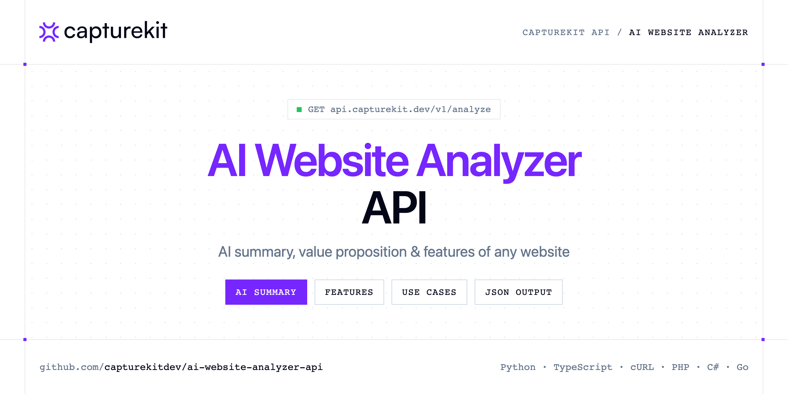

<p align="center">
  <a href="https://www.capturekit.dev"></a>
</p>

# AI Website Analyzer API

[](https://discord.gg/CFj3ph8aHU) [](https://app.capturekit.dev/register) [](https://app.capturekit.dev/openapi) [](LICENSE)

The **CaptureKit Analyze API** reads a website and returns AI insights: summary, value proposition, features, categories, use cases and optional contact signals.

- **Analyze (AI) API** — AI Content API analyzes any webpage and returns AI insights summary, value proposition, features, categories, use cases, and optional contact signals.

Use it for lead enrichment, competitor intelligence, directories and sales research.

| Endpoint | Request | Credits |
|---|---|---|
| [Analyze (AI) API](#analyze-ai-api) | `GET /v1/analyze` | 1 |

## Table of contents

- [How it works](#how-it-works)
- [Analyze (AI) API](#analyze-ai-api)
- [Code examples in other languages](#code-examples-in-other-languages)
- [Use cases](#use-cases)
- [Why CaptureKit?](#why-capturekit)
- [FAQ](#faq)
- [Official SDKs](#official-sdks)
- [Related repositories](#related-repositories)
- [Support](#support)

## How it works

1. **Create a CaptureKit account** and copy your API key from the [dashboard](https://app.capturekit.dev/register).
2. **Call `https://api.capturekit.dev`** with the header `x-api-key: YOUR_API_KEY`.
3. **Use the result** in your app — no infrastructure to run.

```bash
export CAPTUREKIT_API_KEY="your-api-key"
pip install requests        # Python
# TypeScript: Node.js 18+ (native fetch), run with `npx tsx file.ts`
```

## Analyze (AI) API

AI Content API analyzes any webpage and returns AI insights summary, value proposition, features, categories, use cases, and optional contact signals.

`GET https://api.capturekit.dev/v1/analyze` · **1 credit per request** · [API reference](https://app.capturekit.dev/openapi)

### Request parameters

| Parameter | In | Type | Required | Description |
|---|---|---|---|---|
| `url` | query | string | ✅ | The URL of the webpage to capture. |
| `custom_response` | query | string | — | Pass custom response fields to be included in the AI response. |
| `custom_prompt` | query | string | — | Add your own instructions to guide the AI’s analysis. |
| `proxy` | query | string | — | Specify a proxy server to route your request through. |
| `cache` | query | boolean | — | Cache the response. |
| `cache_ttl` | query | number | — | Cache the response for a custom TTL (in seconds). |

### Python example

```python
import os

import requests

API_KEY = os.environ["CAPTUREKIT_API_KEY"]
HEADERS = {"x-api-key": API_KEY}

response = requests.get(
    "https://api.capturekit.dev/v1/analyze",
    headers=HEADERS,
    params={
        "url": "https://github.com/seaweedfs/seaweedfs",
    },
    timeout=120,
)
response.raise_for_status()

data = response.json()
print(data)
```

### TypeScript example

```typescript
type AnalyzeAiApi = {
  data?: {
    emails?: string[];
    summary?: string;
    useCases?: string[];
    categories?: string[];
    keyFeatures?: string[];
    phoneNumbers?: string[];
    targetAudience?: string;
    valueProposition?: string;
  };
  success?: boolean;
};

const headers = { "x-api-key": process.env.CAPTUREKIT_API_KEY!, "Content-Type": "application/json" };

const params = new URLSearchParams({
  "url": "https://github.com/seaweedfs/seaweedfs",
});

const response = await fetch(`https://api.capturekit.dev/v1/analyze?${params}`, { headers });
if (!response.ok) throw new Error(`HTTP ${response.status}: ${await response.text()}`);

const data = (await response.json()) as AnalyzeAiApi;
console.log(data);
```

### Output example

Example response from the API reference, abridged.

```json
{
  "data": {
    "emails": [
      "admin@company.com"
    ],
    "summary": "Tailwind CSS is a utility-first CSS framework for modern web design.",
    "useCases": [
      "Building websites",
      "Customizing themes"
    ],
    "categories": [
      "Web Development",
      "CSS Frameworks"
    ],
    "keyFeatures": [
      "Responsive design",
      "Dark mode"
    ],
    "phoneNumbers": [
      "+13322767084"
    ],
    "targetAudience": "Web developers and designers.",
    "valueProposition": "A flexible CSS framework packed with utility classes."
  },
  "success": true
}
```

### Response fields

| Field | Type | Description |
|---|---|---|
| `data` | object |  |
| `data.emails` | string[] |  |
| `data.summary` | string |  |
| `data.useCases` | string[] |  |
| `data.categories` | string[] |  |
| `data.keyFeatures` | string[] |  |
| `data.phoneNumbers` | string[] |  |
| `data.targetAudience` | string |  |
| `data.valueProposition` | string |  |
| `success` | boolean |  |

## Code examples in other languages

Ready-to-run examples live in [`examples/`](examples); each reads your key from `CAPTUREKIT_API_KEY`.

| Language | `analyze` |
|---|---|
| cURL (Bash) | [analyze.sh](examples/curl/analyze.sh) |
| PHP | [analyze.php](examples/php/analyze.php) |
| C# | [Analyze.cs](examples/csharp/Analyze.cs) |
| Go | [analyze.go](examples/go/analyze.go) |
| Java | [AnalyzeExample.java](examples/java/AnalyzeExample.java) |
| Ruby | [analyze.rb](examples/ruby/analyze.rb) |
| Node.js | [analyze.mjs](examples/nodejs/analyze.mjs) |

## Use cases

- **Lead enrichment** — Qualify companies from their website.
- **Competitor intelligence** — Summarise competitors' positioning at scale.

## Why CaptureKit?

- **Screenshots as a service** — the response body *is* the image or PDF; save it or upload it straight to your S3 bucket.
- **Pixel-perfect options** — full page, viewport size, scale factor, element `selector`, 18 mobile/tablet devices, delays and wait conditions.
- **Clean pages** — remove cookie banners, ads and any CSS selector before capturing.
- **Beyond screenshots** — extract content (metadata, links, HTML, Markdown) or get an AI analysis of any page.
- **Copy-paste examples** — Python and TypeScript in each README, 7 more languages in `examples/`.

## FAQ

### How do I authenticate?

Create an account on [CaptureKit](https://app.capturekit.dev/register), copy your API key and send it in the `x-api-key` header of every request to `https://api.capturekit.dev`.

### How much does a request cost?

Credits per call: `/v1/analyze` **1**. See [CaptureKit pricing](https://www.capturekit.dev/pricing).

### Which languages are supported?

Any language that can make an HTTP request. This README shows Python and TypeScript; the [`examples/`](examples) folder contains cURL, PHP, C#, Go, Java, Ruby and Node.js.

## Official SDKs

Use CaptureKit from your own language with a typed client:

| SDK | Package | Install |
| --- | --- | --- |
| Node.js | [`@capturekitdev/sdk`](https://www.npmjs.com/package/@capturekitdev/sdk) | `npm install @capturekitdev/sdk` |
| Python | [`capturekitdev`](https://pypi.org/project/capturekitdev/) | `pip install capturekitdev` |
| Go | [`capturekit-go`](https://pkg.go.dev/github.com/capturekitdev/capturekit-go) | `go get github.com/capturekitdev/capturekit-go` |
| .NET | [`CaptureKit`](https://www.nuget.org/packages/CaptureKit) | `dotnet add package CaptureKit` |
| Ruby | [`capturekitdev`](https://rubygems.org/gems/capturekitdev) | `gem install capturekitdev` |
| PHP | [`capturekitdev/sdk`](https://packagist.org/packages/capturekitdev/sdk) | `composer require capturekitdev/sdk` |
| Java | [`capturekit-java`](https://github.com/capturekitdev/capturekit-java) | build from source, see its README |
| CLI | [`@capturekitdev/cli`](https://www.npmjs.com/package/@capturekitdev/cli) | `npm install -g @capturekitdev/cli` |
| MCP server | [`@capturekitdev/mcp`](https://www.npmjs.com/package/@capturekitdev/mcp) | `npx -y @capturekitdev/mcp` |

## Related repositories

- [Screenshot API](https://github.com/capturekitdev/website-screenshot-api)
- [Full Page Screenshot API](https://github.com/capturekitdev/full-page-screenshot-api)
- [Website to PDF API](https://github.com/capturekitdev/website-to-pdf-api)
- [Mobile Screenshot API](https://github.com/capturekitdev/mobile-screenshot-api)
- [Website Content API](https://github.com/capturekitdev/website-content-api)
- [Website Crawler API](https://github.com/capturekitdev/website-crawler-api)
- [All CaptureKit repositories](https://github.com/capturekitdev)

## Support

- 💬 Join the [Discord](https://discord.gg/CFj3ph8aHU) to ask questions and share what you build.
- 📚 Read the [API reference](https://app.capturekit.dev/openapi).
- 🔑 [Get your API key](https://app.capturekit.dev/register).

---

<p align="center">
  <a href="https://www.capturekit.dev">
    <picture>
      <source media="(prefers-color-scheme: dark)" srcset="images/logo-dark.svg">
      
    </picture>
  </a>
  <br>
  <sub>Built by <a href="https://www.capturekit.dev">CaptureKit</a>. Examples are released under the MIT license.</sub>
</p>
